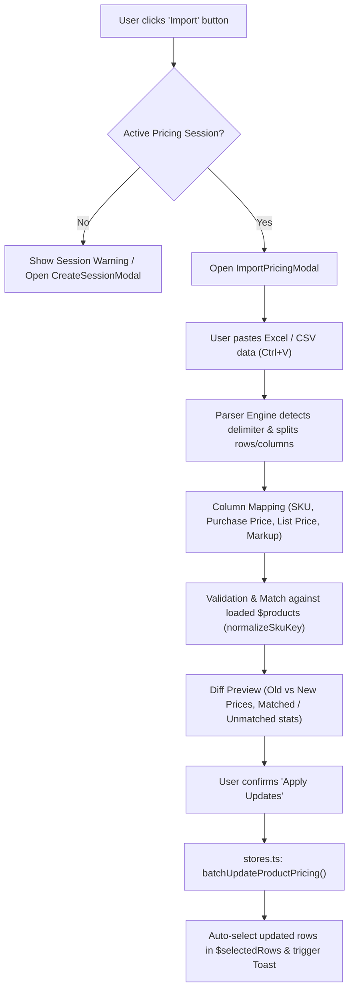

# Product Pricing Excel / CSV Import Implementation Guide

This guide details how to implement an **Import Pricing Modal** in [`src/routes/(protected)/update-product-pricing`](file:///c:/Users/ASUS/Documents/Rapid%20Clean/rapidtools/src/routes/%28protected%29/update-product-pricing). 

The feature allows users to copy tabular data directly from **Microsoft Excel, Google Sheets, or CSV files** (e.g., columns with SKU, Purchase Price, List Price / RRP, or Markup), paste it into a modal, preview the price changes and validation status, and auto-populate the pricing table and stores.

---

## Architecture Overview



---

## Implementation Breakdown (Split into Small Sections)

To implement this feature safely and maintainably, divide the work into **5 distinct phases**:

1. [**Section 1: Data Contracts & Type Definitions** (`types.ts`)](#section-1-data-contracts--type-definitions)
2. [**Section 2: Parser & Matching Engine** (`utils/importParser.ts`)](#section-2-parser--matching-engine)
3. [**Section 3: Batch Update Logic in Store** (`stores.ts`)](#section-3-batch-update-logic-in-store)
4. [**Section 4: Modal UI Component** (`components/ImportPricingModal.svelte`)](#section-4-modal-ui-component)
5. [**Section 5: Toolbar & Page Integration** (`+page.svelte`)](#section-5-toolbar--page-integration)

---

## Section 1: Data Contracts & Type Definitions

Add the import data contracts to [`src/routes/(protected)/update-product-pricing/types.ts`](file:///c:/Users/ASUS/Documents/Rapid%20Clean/rapidtools/src/routes/%28protected%29/update-product-pricing/types.ts).

### 1.1 Column Mapping & Import Target
Users can paste multi-column data where columns represent different attributes:

```typescript
export type ImportTargetField = 
  | 'sku' 
  | 'purchase_price' 
  | 'rrp' 
  | 'markup' 
  | 'ignore';

export interface ColumnMapping {
  columnIndex: number;
  headerName: string;
  targetField: ImportTargetField;
}
```

### 1.2 Parsed & Matched Item Preview
Represents a row parsed from the clipboard and matched against an existing product:

```typescript
export type ImportRowStatus = 
  | 'ready'            // Valid SKU and valid price change
  | 'unmatched_sku'    // SKU does not exist in current session/products
  | 'invalid_number'   // Price or markup could not be parsed into a positive number
  | 'no_change'        // Values are identical to current product values
  | 'duplicate_sku';   // SKU appeared multiple times in the pasted data

export interface ImportPreviewItem {
  id: string;               // Unique row key (e.g. rowIndex)
  rawSku: string;
  matchedSku?: string;
  productName?: string;
  brand?: string;
  
  // Current values
  currentPurchasePrice?: number;
  currentRrp?: number;
  currentMarkup?: number;

  // New values parsed from paste
  newPurchasePrice?: number;
  newRrp?: number;
  newMarkup?: number;

  // Recalculated values (if purchase_price changed, recalculated RRP or vice versa)
  calculatedRrp?: number;
  calculatedMarkup?: number;
  calculatedGpp?: number;

  // Which field was explicitly supplied
  primarySource: 'purchase_price' | 'rrp' | 'markup';

  status: ImportRowStatus;
  statusMessage?: string;
  selected: boolean;       // Checkbox to include/exclude this row
}

export interface ImportParseSummary {
  totalRows: number;
  matchedCount: number;
  unmatchedCount: number;
  invalidCount: number;
  readyCount: number;
}
```

---

## Section 2: Parser & Matching Engine

Create a dedicated parsing and matching utility file:
`src/routes/(protected)/update-product-pricing/utils/importParser.ts`.

### 2.1 Delimiter & Grid Extraction
When copying from Microsoft Excel or Google Sheets, the clipboard format uses **Tabs (`\t`)** between columns and **Newlines (`\r\n` or `\n`)** between rows. Raw CSVs use commas (`,`) or semicolons (`;`).

```typescript
/**
 * Detect delimiter by counting frequencies in the first non-empty rows.
 */
export function detectDelimiter(text: string): '\t' | ',' | ';' | '|' {
  const sample = text.split(/\r\n|\n/).slice(0, 5).join('\n');
  const tabs = (sample.match(/\t/g) || []).length;
  const commas = (sample.match(/,/g) || []).length;
  const semicolons = (sample.match(/;/g) || []).length;
  const pipes = (sample.match(/\|/g) || []).length;

  if (tabs >= commas && tabs >= semicolons && tabs > 0) return '\t';
  if (commas >= semicolons && commas > 0) return ',';
  if (semicolons > 0) return ';';
  if (pipes > 0) return '|';
  return '\t'; // Default to tab for Excel copy-paste
}

/**
 * Splits clipboard text into a 2D string grid.
 */
export function parseClipboardToGrid(text: string, customDelimiter?: string): string[][] {
  if (!text || !text.trim()) return [];
  const delimiter = customDelimiter || detectDelimiter(text);
  const normalized = text.replace(/\r\n/g, '\n').replace(/\r/g, '\n');
  const rawLines = normalized.split('\n');

  const grid: string[][] = [];
  for (const line of rawLines) {
    if (!line.trim()) continue;
    
    // Split with basic CSV quote escape handling
    let cells: string[];
    if (delimiter === '\t') {
      cells = line.split('\t').map(c => c.trim());
    } else {
      // Regex handling quoted CSV values
      const regex = new RegExp(`(?:^|${delimiter})(?:"([^"]*(?:""[^"]*)*)"|([^"${delimiter}]*))`, 'g');
      cells = [];
      let match: RegExpExecArray | null;
      while ((match = regex.exec(line)) !== null) {
        let val = match[1] !== undefined ? match[1].replace(/""/g, '"') : match[2];
        cells.push((val ?? '').trim());
      }
    }
    if (cells.some(c => c !== '')) {
      grid.push(cells);
    }
  }
  return grid;
}
```

### 2.2 Sanitize Number Inputs
Remove currency symbols (`$`), commas in thousands (`1,250.00`), percentages (`%`), and whitespace:

```typescript
export function cleanNumericValue(val: unknown): number | null {
  if (val == null) return null;
  const str = String(val).replace(/[\$,\s%]/g, '').trim();
  if (!str) return null;
  const num = parseFloat(str);
  return Number.isFinite(num) && num >= 0 ? num : null;
}
```

### 2.3 Auto-Detect Column Headers
Inspect row 0 to detect if headers are present (e.g. "SKU", "Item Code", "Cost", "Purchase Price", "RRP", "List Price"):

```typescript
export function guessColumnMapping(firstRow: string[]): ImportTargetField[] {
  return firstRow.map(rawHeader => {
    const h = rawHeader.toLowerCase().trim();
    if (/sku|item(\s*|_)?code|product(\s*|_)?code|part(\s*|_)?number/i.test(h)) return 'sku';
    if (/purchase|cost|buy|wholesale|supplier(\s*|_)?price/i.test(h)) return 'purchase_price';
    if (/rrp|list(\s*|_)?price|retail|sell|sale(\s*|_)?price/i.test(h)) return 'rrp';
    if (/markup|mup|margin/i.test(h)) return 'markup';
    return 'ignore';
  });
}
```

### 2.4 Matching Against Loaded Products
Use `normalizeSkuKey` to match SKUs regardless of leading/trailing spaces or lowercase/uppercase differences:

```typescript
import { normalizeSkuKey } from '../stores';

export function matchImportRowsWithProducts(
  grid: string[][],
  columnMappings: ImportTargetField[],
  hasHeaderRow: boolean,
  productsList: any[]
): ImportPreviewItem[] {
  // Create quick lookup map by normalized SKU
  const productMap = new Map<string, any>();
  for (const p of productsList) {
    if (p?.sku) {
      productMap.set(normalizeSkuKey(p.sku), p);
    }
  }

  const skuColIdx = columnMappings.indexOf('sku');
  const purchaseColIdx = columnMappings.indexOf('purchase_price');
  const rrpColIdx = columnMappings.indexOf('rrp');
  const markupColIdx = columnMappings.indexOf('markup');

  const startIndex = hasHeaderRow ? 1 : 0;
  const results: ImportPreviewItem[] = [];
  const seenSkus = new Set<string>();

  for (let i = startIndex; i < grid.length; i++) {
    const row = grid[i];
    const rawSku = (skuColIdx >= 0 ? row[skuColIdx] : row[0])?.trim() || '';
    if (!rawSku) continue;

    const normalized = normalizeSkuKey(rawSku);
    const existingProduct = productMap.get(normalized);

    const rawPurchase = purchaseColIdx >= 0 ? cleanNumericValue(row[purchaseColIdx]) : null;
    const rawRrp = rrpColIdx >= 0 ? cleanNumericValue(row[rrpColIdx]) : null;
    const rawMarkup = markupColIdx >= 0 ? cleanNumericValue(row[markupColIdx]) : null;

    let status: ImportRowStatus = 'ready';
    let statusMessage = '';

    if (!existingProduct) {
      status = 'unmatched_sku';
      statusMessage = 'SKU not found in current inventory list';
    } else if (seenSkus.has(normalized)) {
      status = 'duplicate_sku';
      statusMessage = 'Duplicate SKU in import list (prior row takes precedence)';
    } else if (rawPurchase == null && rawRrp == null && rawMarkup == null) {
      status = 'invalid_number';
      statusMessage = 'No valid price or markup provided in this row';
    }

    seenSkus.add(normalized);

    // Determine primary source for pricing recalculation
    let primarySource: 'purchase_price' | 'rrp' | 'markup' = 'purchase_price';
    if (rawPurchase != null) primarySource = 'purchase_price';
    else if (rawRrp != null) primarySource = 'rrp';
    else if (rawMarkup != null) primarySource = 'markup';

    results.push({
      id: `row-${i}-${rawSku}`,
      rawSku,
      matchedSku: existingProduct?.sku,
      productName: existingProduct?.product_name || existingProduct?.Model || '',
      brand: existingProduct?.brand || existingProduct?.Brand || '',
      currentPurchasePrice: existingProduct?.purchase_price,
      currentRrp: existingProduct?.rrp,
      currentMarkup: existingProduct?.markup,
      newPurchasePrice: rawPurchase ?? undefined,
      newRrp: rawRrp ?? undefined,
      newMarkup: rawMarkup ?? undefined,
      primarySource,
      status,
      statusMessage,
      selected: status === 'ready'
    });
  }

  return results;
}
```

---

## Section 3: Batch Update Logic in Store

Updating rows one-by-one with `updateProductPricingBySku` inside a loop can trigger 50–500 individual store notifications, causing severe UI lag. 

Add an optimized batch updater to [`src/routes/(protected)/update-product-pricing/stores.ts`](file:///c:/Users/ASUS/Documents/Rapid%20Clean/rapidtools/src/routes/%28protected%29/update-product-pricing/stores.ts).

### 3.1 Store Function: `batchUpdateProductPricing`

```typescript
export interface BatchPricingUpdateItem {
  sku: string;
  patch: {
    purchase_price?: number;
    rrp?: number;
    markup?: number;
  };
  source: PricingEditSource;
}

/**
 * Updates multiple products in a single store transaction.
 * Automatically marks modified SKUs as selected so the user can review them immediately.
 */
export function batchApplyPricingUpdates(updates: BatchPricingUpdateItem[]): {
  success: boolean;
  updatedCount: number;
} {
  if (!updates || updates.length === 0) {
    return { success: true, updatedCount: 0 };
  }

  // Create lookup for quick patch retrieval
  const updateMap = new Map<string, BatchPricingUpdateItem>();
  for (const item of updates) {
    updateMap.set(normalizeSkuKey(item.sku), item);
  }

  const updatedSkus: string[] = [];

  products.update((list) => {
    let hasModifications = false;
    const nextList = list.map((product) => {
      const skuKey = normalizeSkuKey(product?.sku);
      const updateItem = updateMap.get(skuKey);
      if (!updateItem) return product;

      hasModifications = true;
      updatedSkus.push(product.sku);

      const merged = { ...product, ...updateItem.patch };
      delete merged.rrp_gst_inclusive;
      return computePricing(merged, updateItem.source);
    });

    return hasModifications ? nextList : list;
  });

  // Automatically select the updated rows in the table
  if (updatedSkus.length > 0) {
    selectedRows.update((set) => {
      const nextSet = new Set(set);
      for (const sku of updatedSkus) {
        nextSet.add(sku);
      }
      return nextSet;
    });
  }

  return {
    success: true,
    updatedCount: updatedSkus.length
  };
}
```

---

## Section 4: Modal UI Component

Create [`src/routes/(protected)/update-product-pricing/components/ImportPricingModal.svelte`](file:///c:/Users/ASUS/Documents/Rapid%20Clean/rapidtools/src/routes/%28protected%29/update-product-pricing/components/ImportPricingModal.svelte).

### 4.1 Step Progression & Component State
Use a 3-step or 2-step workflow:
1. **Paste / Upload Step**:
   - Multi-line textarea with auto-focus.
   - Excel paste hint: *"Copy rows from Excel and press Ctrl+V here"*.
   - Drag-and-drop CSV / TSV file upload option.
   - Options: Delimiter selector (Auto / Tab / Comma), "First row contains headers" toggle.
2. **Preview & Column Mapping Step**:
   - Summary stat cards:
     - 🟢 **Ready to Update** (count)
     - 🔴 **Unmatched SKUs** (count)
     - ⚠️ **Invalid / No Price** (count)
   - Column mapping dropdowns (e.g. Column 1: SKU, Column 2: Purchase Price, Column 3: List Price).
   - Side-by-side Diff Table:
     - Checkbox per row (select all / deselect all).
     - SKU & Product Name.
     - Purchase Price: `Old -> New` (with green/red indicator).
     - List Price: `Old -> New`.
     - Status Badge (`Ready`, `Unmatched`, `Invalid`).
3. **Actions**:
   - "Back to Paste"
   - "Apply X Updates" (primary button in lime green).

### 4.2 Component Blueprint

```svelte
<script lang="ts">
  import { createEventDispatcher } from 'svelte';
  import { products, normalizeSkuKey, batchApplyPricingUpdates } from '../stores';
  import { 
    parseClipboardToGrid, 
    guessColumnMapping, 
    matchImportRowsWithProducts 
  } from '../utils/importParser';
  import type { ImportTargetField, ImportPreviewItem } from '../types';
  import { toastSuccess, toastError } from '$lib/utils/toast';

  export let open: boolean = false;
  export let onClose: () => void;

  const dispatch = createEventDispatcher();

  let step: 'input' | 'preview' = 'input';
  let pasteContent: string = '';
  let hasHeaderRow: boolean = true;
  let detectedDelimiter: string = '\t';
  let grid: string[][] = [];
  let columnMappings: ImportTargetField[] = [];
  let previewItems: ImportPreviewItem[] = [];

  // Summary counts
  $: readyItems = previewItems.filter(i => i.status === 'ready');
  $: readySelectedCount = previewItems.filter(i => i.status === 'ready' && i.selected).length;
  $: unmatchedCount = previewItems.filter(i => i.status === 'unmatched_sku').length;
  $: invalidCount = previewItems.filter(i => i.status === 'invalid_number').length;

  function handleProcessPaste() {
    if (!pasteContent.trim()) {
      toastError('Please paste Excel or CSV data first.');
      return;
    }

    grid = parseClipboardToGrid(pasteContent);
    if (grid.length === 0) {
      toastError('No valid tabular data found.');
      return;
    }

    // Auto-detect mappings from header row
    columnMappings = guessColumnMapping(grid[0]);
    if (!columnMappings.includes('sku')) {
      columnMappings[0] = 'sku'; // Default first column to SKU if undetected
    }
    if (!columnMappings.includes('purchase_price') && grid[0].length > 1) {
      columnMappings[1] = 'purchase_price'; // Default second column to purchase price
    }

    runMatching();
    step = 'preview';
  }

  function runMatching() {
    previewItems = matchImportRowsWithProducts(
      grid,
      columnMappings,
      hasHeaderRow,
      $products
    );
  }

  function toggleSelectAll(checked: boolean) {
    previewItems = previewItems.map(item => 
      item.status === 'ready' ? { ...item, selected: checked } : item
    );
  }

  function handleApplyUpdates() {
    const toApply = previewItems.filter(i => i.status === 'ready' && i.selected && i.matchedSku);
    if (toApply.length === 0) {
      toastError('No items selected for update.');
      return;
    }

    const updates = toApply.map(item => ({
      sku: item.matchedSku!,
      patch: {
        ...(item.newPurchasePrice != null ? { purchase_price: item.newPurchasePrice } : {}),
        ...(item.newRrp != null ? { rrp: item.newRrp } : {}),
        ...(item.newMarkup != null ? { markup: item.newMarkup } : {})
      },
      source: item.primarySource
    }));

    const result = batchApplyPricingUpdates(updates);
    if (result.success) {
      toastSuccess(`Successfully updated ${result.updatedCount} products.`);
      onClose();
      resetState();
    }
  }

  function resetState() {
    step = 'input';
    pasteContent = '';
    grid = [];
    previewItems = [];
  }
</script>

{#if open}
  <div class="fixed inset-0 z-50 flex items-center justify-center bg-black/75 backdrop-blur-sm p-4">
    <div class="relative flex flex-col w-full max-w-4xl max-h-[90vh] bg-[#141619] border border-[#262a30] rounded-2xl shadow-2xl overflow-hidden">
      
      <!-- Modal Header -->
      <div class="flex items-center justify-between border-b border-[#262a30] px-6 py-4 bg-[#181b20]">
        <div>
          <h2 class="text-lg font-bold text-white tracking-tight">Import Pricing from Excel / CSV</h2>
          <p class="text-xs text-gray-400 mt-0.5">Copy columns directly from your spreadsheet and paste them below</p>
        </div>
        <button 
          type="button" 
          class="text-gray-400 hover:text-white transition-colors"
          on:click={onClose}
          aria-label="Close"
        >
          <svg class="w-5 h-5" fill="none" viewBox="0 0 24 24" stroke="currentColor">
            <path stroke-linecap="round" stroke-linejoin="round" stroke-width="2" d="M6 18L18 6M6 6l12 12" />
          </svg>
        </button>
      </div>

      <!-- Modal Body -->
      <div class="p-6 overflow-y-auto flex-1 space-y-4">
        {#if step === 'input'}
          <div>
            <label for="paste-input" class="block text-xs font-semibold text-gray-300 uppercase tracking-wider mb-2">
              Paste Spreadsheet Data
            </label>
            <textarea
              id="paste-input"
              bind:value={pasteContent}
              rows="10"
              placeholder="Paste cells copied from Excel or Google Sheets here...&#10;&#10;Example:&#10;SKU&#9;Cost&#9;RRP&#10;ABC-101&#9;15.50&#9;24.95&#10;ABC-102&#9;32.00&#9;49.00"
              class="w-full font-mono text-xs p-3 rounded-xl bg-[#0e1012] border border-[#262a30] text-gray-200 placeholder-gray-600 focus:border-lime-500 focus:ring-1 focus:ring-lime-500 transition-colors"
            ></textarea>
          </div>

          <div class="flex flex-wrap items-center justify-between gap-4 pt-2">
            <label class="flex items-center gap-2 cursor-pointer">
              <input 
                type="checkbox" 
                bind:checked={hasHeaderRow} 
                class="rounded border-[#262a30] bg-[#0e1012] text-lime-500 focus:ring-lime-500/20"
              />
              <span class="text-xs text-gray-300">First row contains column headers</span>
            </label>
          </div>

        {:else if step === 'preview'}
          <!-- Stats Summary Bar -->
          <div class="grid grid-cols-3 gap-3">
            <div class="p-3 rounded-xl bg-lime-500/10 border border-lime-500/20">
              <span class="text-[10px] font-semibold text-lime-400 uppercase tracking-wider">Ready to Update</span>
              <p class="text-xl font-bold text-white mt-1">{readySelectedCount} / {readyItems.length}</p>
            </div>
            <div class="p-3 rounded-xl bg-amber-500/10 border border-amber-500/20">
              <span class="text-[10px] font-semibold text-amber-400 uppercase tracking-wider">Unmatched SKUs</span>
              <p class="text-xl font-bold text-white mt-1">{unmatchedCount}</p>
            </div>
            <div class="p-3 rounded-xl bg-red-500/10 border border-red-500/20">
              <span class="text-[10px] font-semibold text-red-400 uppercase tracking-wider">Invalid Values</span>
              <p class="text-xl font-bold text-white mt-1">{invalidCount}</p>
            </div>
          </div>

          <!-- Column Mapping Controls -->
          <div class="p-4 rounded-xl bg-[#181b20] border border-[#262a30] space-y-2">
            <h3 class="text-xs font-semibold text-gray-300 uppercase tracking-wider">Column Assignments</h3>
            <div class="flex flex-wrap gap-3">
              {#each columnMappings as mapping, idx}
                <div class="flex items-center gap-2 bg-[#0e1012] border border-[#262a30] rounded-lg px-2.5 py-1.5">
                  <span class="text-[11px] text-gray-400 font-mono">Col {idx + 1}:</span>
                  <select 
                    bind:value={columnMappings[idx]} 
                    on:change={runMatching}
                    class="bg-transparent text-xs text-white border-0 p-0 focus:ring-0 cursor-pointer"
                  >
                    <option value="sku">SKU</option>
                    <option value="purchase_price">Purchase Price</option>
                    <option value="rrp">List Price (RRP)</option>
                    <option value="markup">Markup</option>
                    <option value="ignore">Skip / Ignore</option>
                  </select>
                </div>
              {/each}
            </div>
          </div>

          <!-- Preview Table -->
          <div class="border border-[#262a30] rounded-xl overflow-hidden max-h-72 overflow-y-auto">
            <table class="w-full text-left text-xs text-gray-300">
              <thead class="bg-[#181b20] text-gray-400 sticky top-0 border-b border-[#262a30]">
                <tr>
                  <th class="p-2.5 w-10">
                    <input 
                      type="checkbox" 
                      checked={readySelectedCount === readyItems.length && readyItems.length > 0} 
                      on:change={(e) => toggleSelectAll(e.currentTarget.checked)}
                      class="rounded border-[#262a30] bg-[#0e1012] text-lime-500 focus:ring-lime-500/20"
                    />
                  </th>
                  <th class="p-2.5 font-semibold">SKU</th>
                  <th class="p-2.5 font-semibold">Product Name</th>
                  <th class="p-2.5 font-semibold text-right">Cost (Old &rarr; New)</th>
                  <th class="p-2.5 font-semibold text-right">RRP (Old &rarr; New)</th>
                  <th class="p-2.5 font-semibold text-center">Status</th>
                </tr>
              </thead>
              <tbody class="divide-y divide-[#262a30]">
                {#each previewItems as item}
                  <tr class="hover:bg-[#181b20]/50 transition-colors">
                    <td class="p-2.5">
                      <input 
                        type="checkbox" 
                        bind:checked={item.selected} 
                        disabled={item.status !== 'ready'}
                        class="rounded border-[#262a30] bg-[#0e1012] text-lime-500 focus:ring-lime-500/20 disabled:opacity-40"
                      />
                    </td>
                    <td class="p-2.5 font-mono text-white font-medium">{item.rawSku}</td>
                    <td class="p-2.5 max-w-[200px] truncate text-gray-400">{item.productName || '—'}</td>
                    <td class="p-2.5 text-right font-mono">
                      {#if item.newPurchasePrice != null}
                        <span class="text-gray-500 line-through">${(item.currentPurchasePrice ?? 0).toFixed(2)}</span>
                        &rarr;
                        <span class="text-lime-400 font-bold">${item.newPurchasePrice.toFixed(2)}</span>
                      {:else}
                        <span class="text-gray-500">—</span>
                      {/if}
                    </td>
                    <td class="p-2.5 text-right font-mono">
                      {#if item.newRrp != null}
                        <span class="text-gray-500 line-through">${(item.currentRrp ?? 0).toFixed(2)}</span>
                        &rarr;
                        <span class="text-lime-400 font-bold">${item.newRrp.toFixed(2)}</span>
                      {:else}
                        <span class="text-gray-500">—</span>
                      {/if}
                    </td>
                    <td class="p-2.5 text-center">
                      {#if item.status === 'ready'}
                        <span class="px-2 py-0.5 rounded text-[10px] font-semibold bg-lime-500/10 text-lime-400 border border-lime-500/20">Ready</span>
                      {:else if item.status === 'unmatched_sku'}
                        <span class="px-2 py-0.5 rounded text-[10px] font-semibold bg-amber-500/10 text-amber-400 border border-amber-500/20" title={item.statusMessage}>SKU Missing</span>
                      {:else}
                        <span class="px-2 py-0.5 rounded text-[10px] font-semibold bg-red-500/10 text-red-400 border border-red-500/20" title={item.statusMessage}>Invalid</span>
                      {/if}
                    </td>
                  </tr>
                {/each}
              </tbody>
            </table>
          </div>
        {/if}
      </div>

      <!-- Modal Footer -->
      <div class="flex items-center justify-between border-t border-[#262a30] px-6 py-4 bg-[#181b20]">
        {#if step === 'preview'}
          <button 
            type="button" 
            class="btn-secondary text-xs py-2 px-4"
            on:click={() => (step = 'input')}
          >
            &larr; Back to Paste
          </button>
        {:else}
          <div></div>
        {/if}

        <div class="flex items-center gap-2">
          <button 
            type="button" 
            class="btn-secondary text-xs py-2 px-4"
            on:click={onClose}
          >
            Cancel
          </button>

          {#if step === 'input'}
            <button 
              type="button" 
              class="btn-primary text-xs py-2 px-4"
              disabled={!pasteContent.trim()}
              on:click={handleProcessPaste}
            >
              Parse & Preview &rarr;
            </button>
          {:else}
            <button 
              type="button" 
              class="btn-primary text-xs py-2 px-4"
              disabled={readySelectedCount === 0}
              on:click={handleApplyUpdates}
            >
              Apply {readySelectedCount} Updates
            </button>
          {/if}
        </div>
      </div>

    </div>
  </div>
{/if}
```

---

## Section 5: Toolbar & Page Integration

Integrate the new import component and button into [`src/routes/(protected)/update-product-pricing/+page.svelte`](file:///c:/Users/ASUS/Documents/Rapid%20Clean/rapidtools/src/routes/%28protected%29/update-product-pricing/+page.svelte).

### 5.1 Add Component Import & State
In the `<script>` section of `+page.svelte`:

```svelte
import ImportPricingModal from './components/ImportPricingModal.svelte';

let showImportPricingModal = false;

function openImportPricingModal() {
  if (!$currentSession) {
    toastError('Please create or resume a pricing session first.');
    $showCreateSessionModal = true;
    return;
  }
  showImportPricingModal = true;
}
```

### 5.2 Add Button in Toolbar
In the middle column toolbar (alongside *Mass Price Change* and *Print Tags*):

```svelte
<div class="mass-price-change-toolbar mb-4 flex flex-wrap items-center gap-2.5 rounded-xl bg-[#181b20] p-3 border border-[#262a30] shadow-sm">
  <button
    type="button"
    class="btn-primary text-xs py-2 px-3 inline-flex items-center gap-1.5"
    on:click={() => (showMassPriceChangeModal = true)}
  >
    Mass Price Change
  </button>

  <!-- NEW IMPORT BUTTON -->
  <button
    type="button"
    class="btn-secondary text-xs py-2 px-3 inline-flex items-center gap-1.5 text-lime-400 hover:text-lime-300 border-lime-500/30 hover:border-lime-500/60 transition-colors"
    on:click={openImportPricingModal}
  >
    <svg class="w-4 h-4" fill="none" viewBox="0 0 24 24" stroke="currentColor">
      <path stroke-linecap="round" stroke-linejoin="round" stroke-width="2" d="M4 16v1a3 3 0 003 3h10a3 3 0 003-3v-1m-4-8l-4-4m0 0L8 8m4-4v12" />
    </svg>
    <span>Import Excel / CSV</span>
  </button>

  <button
    type="button"
    class="btn-secondary text-xs py-2 px-3 inline-flex items-center gap-1.5"
    disabled={$selectedRows.size === 0}
    on:click={handlePrintBarcode}
  >
    Print Tags
  </button>
</div>
```

### 5.3 Mount Modal in Page Markup
At the bottom of `+page.svelte`:

```svelte
<ImportPricingModal
  open={showImportPricingModal}
  onClose={() => (showImportPricingModal = false)}
/>
```

---

## Edge Cases & Error Handling Checklist

| Scenario | Handled By | Behavior |
| :--- | :--- | :--- |
| **No active session** | `openImportPricingModal` Guard | Prompts user to start a session before pasting. |
| **Pasting with `$` or commas** | `cleanNumericValue` | Sanitizes `$1,299.99` into `1299.99`. |
| **Case differences in SKU** | `normalizeSkuKey` | Matches `abc-100` with `ABC-100`. |
| **SKU does not exist in inventory** | `matchImportRowsWithProducts` | Marks row as `unmatched_sku` and excludes it from selection. |
| **Duplicate SKUs in paste** | `seenSkus Set` | Flags duplicate rows to prevent accidental overwrites. |
| **Large pastes (300+ items)** | `batchApplyPricingUpdates` | Performs single atomic Svelte store update, avoiding 300 UI re-renders. |
| **Pasted only Purchase Price** | `computePricing` | Automatically recalculates list price and markup based on product pricing rules. |
| **Pasted only List Price** | `computePricing` | Automatically recalculates markup based on purchase price. |

---

## Verification & Manual Testing Checklist for Users

When testing the implementation:
1. **Session Gate**: Verify the Import button prompts for a session if none is active.
2. **Direct Copy-Paste from Excel**:
   - Select 2 columns in Excel (Column A: SKU, Column B: Cost).
   - Press `Ctrl+C`.
   - Click **Import Excel / CSV** in the app and press `Ctrl+V`.
   - Confirm columns are identified properly.
3. **CSV Copy-Paste**:
   - Paste comma-separated text like `SKU,Cost,RRP` with header row.
   - Verify toggle for *"First row contains column headers"* works.
4. **Matching & Diff Review**:
   - Verify existing products show their current and new prices.
   - Intentionally include an invalid SKU (e.g. `NONEXISTENT-999`) and confirm it displays as `SKU Missing`.
5. **Table Population**:
   - Click **Apply Updates**.
   - Check that the modified products update in the main table.
   - Confirm that modified rows are checked/selected in the table checkboxes.
   - Click **Confirm & Submit** to verify saving to the backend session workflow.
