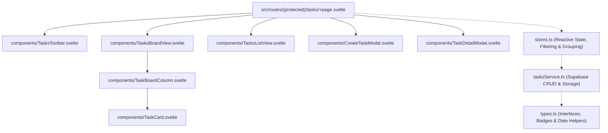

# Tasks Module — Master Implementation Guide (`docs/tasks/`)

This folder contains the phased implementation specification for the **Tasks** page (`/tasks`) in RapidTools. Each subphase is written as a self-contained blueprint so smaller AI coding models can implement one subphase at a time with minimal context window usage and zero ambiguity.

---

## 1. Architecture & Component Tree



---

## 2. Target File Structure

All frontend code for the Tasks module lives inside `src/routes/(protected)/tasks/`:

```text
src/routes/(protected)/tasks/
├── +page.svelte                       # Subphase 3 (updated in 5, 6, 7, 8)
├── types.ts                           # Subphase 1
├── tasksService.ts                    # Subphase 2
├── stores.ts                          # Subphase 2
└── components/
    ├── TasksToolbar.svelte            # Subphase 3
    ├── TaskCard.svelte                # Subphase 4
    ├── TaskBoardColumn.svelte         # Subphase 5
    ├── TasksBoardView.svelte          # Subphase 5
    ├── TasksListView.svelte           # Subphase 6
    ├── CreateTaskModal.svelte         # Subphase 7
    ├── TaskDetailModal.svelte         # Subphase 8
    └── TaskPhotoViewer.svelte         # Subphase 9
```

---

## 3. Subphase Execution Order (For Smaller Models)

Feed one markdown file at a time in the exact order below:

| Subphase | Document | Target Files | Scope Summary |
| :--- | :--- | :--- | :--- |
| **Phase 1** | [`01_SUPABASE_SCHEMA_AND_TYPES.md`](./01_SUPABASE_SCHEMA_AND_TYPES.md) | Supabase SQL + `types.ts` | Database tables (`tasks`, `task_steps`, `task_attachments`, `task_comments`), seed SQL matching the UI screenshot, TypeScript interfaces, and badge/date helpers. |
| **Phase 2** | [`02_SUPABASE_SERVICE_AND_STORES.md`](./02_SUPABASE_SERVICE_AND_STORES.md) | `tasksService.ts`, `stores.ts` | Supabase CRUD service, checklist step operations, attachment storage, comments, and Svelte stores (`filteredTasks`, `groupedTasks`, `taskSummaryStats`). |
| **Phase 3** | [`03_PAGE_SHELL_AND_TOOLBAR.md`](./03_PAGE_SHELL_AND_TOOLBAR.md) | `TasksToolbar.svelte`, `+page.svelte` | Header (`Tasks`, `+ New task`), tabs (`All tasks`, `My tasks`, `Assigned by me`), status counters (`5 open · 1 due today · 1 overdue`), filters (`Search`, `Assignee`, `Status`, `Due date`), `Group by`, and `Board`/`List` switcher. |
| **Phase 4** | [`04_TASK_CARD_COMPONENT.md`](./04_TASK_CARD_COMPONENT.md) | `TaskCard.svelte` | Kanban card with inline status pill dropdown, `...` menu, title, checklist progress bar (`50% · 3 of 6 steps`), assignee avatar + initials, priority/done badge, due date pill, latest note date, and comment count. |
| **Phase 5** | [`05_KANBAN_BOARD_VIEW.md`](./05_KANBAN_BOARD_VIEW.md) | `TaskBoardColumn.svelte`, `TasksBoardView.svelte` | 5-column Kanban board (`Accounts`, `Workshop`, `IT`, `Operations`, `Purchasing` or dynamic `Group by`), colored column header dots, task counts, and column `+ Add task` button. |
| **Phase 6** | [`06_LIST_VIEW.md`](./06_LIST_VIEW.md) | `TasksListView.svelte` | Grouped table view when toggled to `List`, displaying inline status, progress bar, assignee, priority, due date, latest note, and comment count. |
| **Phase 7** | [`07_CREATE_TASK_MODAL.md`](./07_CREATE_TASK_MODAL.md) | `CreateTaskModal.svelte` | Exact **New task** modal (`Task title *`, `Description`, `Assignee *`, `Department`, `Priority`, `Due date *`, `Status`, dynamic `Checklist` steps builder, and `Add attachments`). |
| **Phase 8** | [`08_TASK_DETAIL_DRAWER.md`](./08_TASK_DETAIL_DRAWER.md) | `TaskDetailModal.svelte` | Task detail modal/drawer to check/uncheck steps with live progress bar updates, edit metadata, update latest note, manage attachments, and post comments. |
| **Phase 9** | [`09_PHOTO_VIEWER.md`](./09_PHOTO_VIEWER.md) | `TaskPhotoViewer.svelte` | Fullscreen photo viewer lightbox (zoom, pan, rotate, download, thumbnail carousel), task gallery grid, card/list photo triggers, and creation preview. |
| **Phase 10** | [`10_TASK_SORTING.md`](./10_TASK_SORTING.md) | `types.ts`, `stores.ts`, `TasksToolbar.svelte`, `TasksListView.svelte` | Task sorting by Date time added (`created_at`), Priority (`Urgent`/`High`/`Normal`), and Due date (`due_date`) across Board and List views. |
| **Phase 11** | [`11_NEW_TASK_INDICATOR_AND_SUMMARY.md`](./11_NEW_TASK_INDICATOR_AND_SUMMARY.md) | `types.ts`, `stores.ts`, `TaskCard.svelte`, `TasksListView.svelte`, `TasksToolbar.svelte`, `+page.svelte` | Red dot indicator on unread cards assigned to the current user, auto-dismiss when opened, and new assigned tasks summary counter. |


---

## 4. Visual & Theme Tokens Reference

All components strictly follow [`docs/THEME_GUIDE.md`](../THEME_GUIDE.md):

- **Page Base Background**: `bg-[#0e1012]`
- **Board Column Surface**: `bg-[#111316]` or `bg-[#141619]` with `border border-[#262a30] rounded-xl`
- **Task Card Surface**: `bg-[#181b20]` with `border border-[#262a30] hover:border-[#333842] rounded-xl`
- **Modal Surface**: `bg-[#141619]` with `border border-[#262a30] rounded-2xl shadow-2xl`
- **Input / Select Surface**: `bg-[#181b20]` or `bg-[#0e1012]` with `border border-[#262a30] focus:border-lime-500 rounded-lg`
- **Primary CTA Button**: `bg-lime-400 hover:bg-lime-300 text-gray-950 font-semibold rounded-lg`
- **Department Dot Colors**:
  - `Accounts`: `bg-blue-500`
  - `Workshop`: `bg-purple-500`
  - `IT`: `bg-cyan-400`
  - `Operations`: `bg-emerald-500`
  - `Purchasing`: `bg-amber-500`
- **Status Indicator Colors**:
  - `To do`: `bg-gray-400` (Progress bar: `bg-lime-500`)
  - `In progress`: `bg-blue-400` (Progress bar: `bg-lime-500`)
  - `Waiting`: `bg-amber-400` (Progress bar: `bg-amber-400`)
  - `Completed`: `bg-emerald-400` (Progress bar: `bg-lime-500`)
